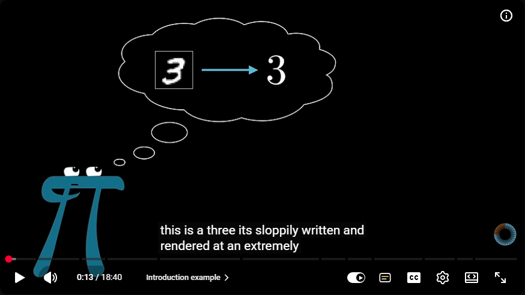
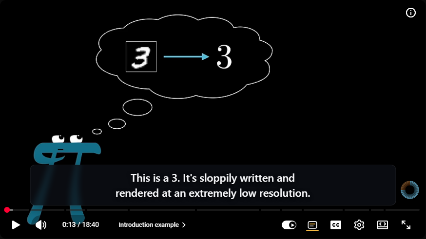
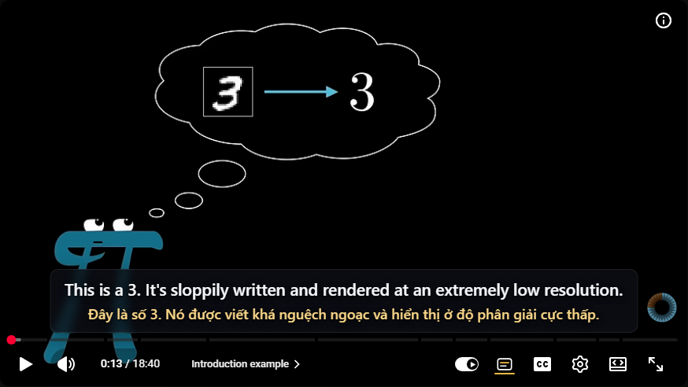
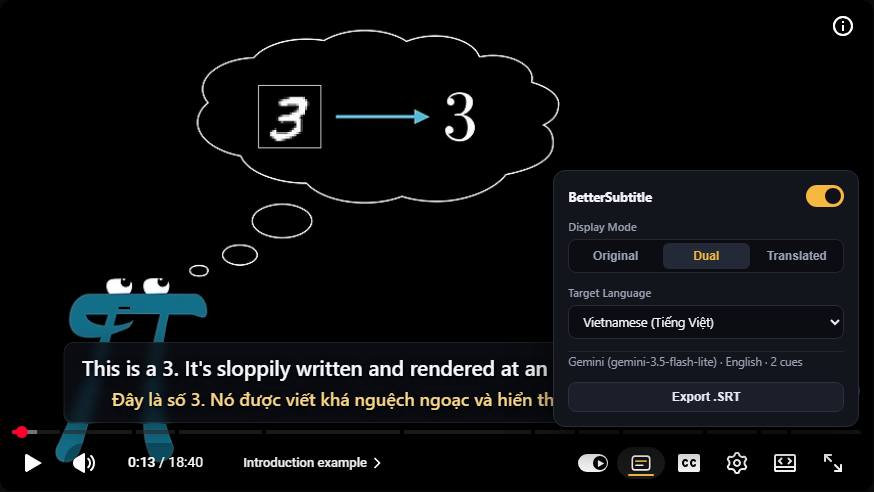
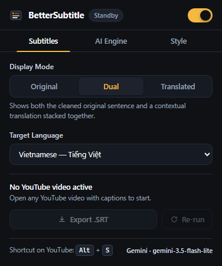
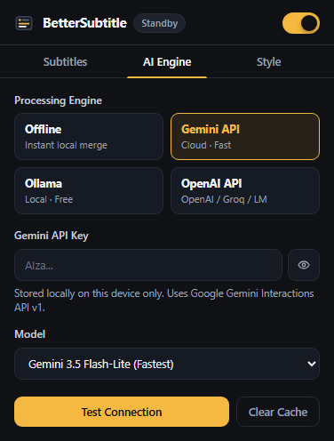
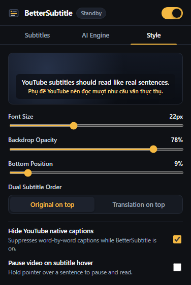

# BetterSubtitle — Smart YouTube Subtitles

[](https://github.com/dungtb1310/subflow-youtube/releases/latest)
[](https://github.com/dungtb1310/subflow-youtube/actions/workflows/ci.yml)


Chrome & Edge (Manifest V3) extension that replaces YouTube's choppy word-by-word auto-captions with **clean sentence-level subtitles**, **flexible language modes** (Refined Original, Translated, or Dual Bilingual), and a **hybrid Cloud + Local AI engine**.

> **Want to use it right away without installing Node.js?** Jump straight to [Quick Install (No Build Required)](#quick-install-recommended--no-nodejs-required) and download the ready-to-use `.zip` from [GitHub Releases](https://github.com/dungtb1310/subflow-youtube/releases/latest).

---

## Before vs. After on YouTube

### 1. Replacing Word-by-Word Auto-Captions with Clean Sentences

| Before — YouTube Default Auto-Captions | After — BetterSubtitle (Original Mode) |
| :---: | :---: |
|  |  |
| Unpunctuated fragments scrolling word by word, cut off mid-sentence | Complete, punctuated sentences with accurate word-aligned timestamps |

### 2. Dual Bilingual Mode & Inline Player Quick Switcher

| Dual Subtitles (English + Vietnamese) | Inline Quick Switcher on YouTube Player |
| :---: | :---: |
|  |  |
| Context-aware bilingual subtitles stacked cleanly without overlapping controls | Switch Original / Dual / Translated, change language, or export `.SRT` without leaving fullscreen |

### 3. Extension Popup Interface

| Subtitles Control | Hybrid AI Engine | Live Style Preview |
| :---: | :---: | :---: |
|  |  |  |

---

## Key Features

- **No more word-by-word scrolling**: Parses YouTube's `timedtext` (`json3` / XML) captions while preserving genuine speech pauses, merging fragmented ASR tokens into readable sentence-level cues.
- **Instant offline mode**: Works right out of the box with zero API keys using pause detection, punctuation heuristics, and English capitalization cleanup.
- **Flexible language modes**:
  - **Original**: Keeps the video's spoken language (e.g. English only) while fixing choppy segmentation and adding proper punctuation.
  - **Dual**: Displays both the cleaned original sentence and a natural contextual translation stacked together.
  - **Translated**: Displays only the natural translation in your chosen target language.
- **Hybrid Cloud + Local AI Engine**:
  - **Gemini API**: Uses Google Gemini Interactions API v1 (`gemini-3.5-flash-lite`, `gemini-4-hydrogen`, `gemini-3.8-flash`, `gemini-3.1-flash-lite`, or custom model) with automatic fallback if a model returns transient `503`/`429`.
  - **Ollama (Local)**: Free, private local processing (`http://localhost:11434`) with one-click model discovery (recommended: `qwen2.5:7b` or `gemma3:4b`).
  - **OpenAI-Compatible**: Built-in presets for OpenAI, Groq, OpenRouter, LM Studio, or any custom `/v1` endpoint.
- **Seek-aware processing & IndexedDB cache**: Prioritizes the exact segment you seek to, prefetches upcoming chunks, and caches processed subtitles locally for 14 days.
- **Cinema-grade overlay**:
  - Trusted-Types-safe Shadow DOM overlay that suppresses YouTube's native captions while active (and restores them when toggled off).
  - Drag subtitles vertically to adjust height; optional hover-to-pause for language learning.
  - Native-style toggle button in the YouTube player control bar, `Alt + S` keyboard shortcut, and one-click **Export .SRT**.

---

## Quick Install (Recommended — No Node.js Required)

You do **not** need Node.js, npm, or any developer tools to install BetterSubtitle:

1. Go to the [**GitHub Releases**](https://github.com/dungtb1310/subflow-youtube/releases/latest) page and download **`BetterSubtitle-vX.Y.Z.zip`**.
2. Extract (unzip) the downloaded archive to a permanent folder on your computer (for example, `C:\Extensions\BetterSubtitle`).
3. Open your browser's extension page:
   - **Chrome / Brave / Arc:** `chrome://extensions`
   - **Microsoft Edge:** `edge://extensions`
4. Turn on **Developer mode** (top-right or left sidebar toggle).
5. Click **Load unpacked** and select the extracted folder (the folder containing `manifest.json`).
6. Open any YouTube video with captions — **BetterSubtitle** activates automatically!

---

## Build from Source (For Developers)

```bash
npm install
npm run build     # Builds MV3 extension into dist/
npm run package   # Builds and packages release/BetterSubtitle-v<version>.zip
```

Then load the generated `dist/` folder via **Load unpacked** in `chrome://extensions` or `edge://extensions`.

### Publishing a New GitHub Release

Pushing a semantic version tag automatically runs tests, packages `BetterSubtitle-vX.Y.Z.zip` + `SHA256SUMS.txt`, and publishes a GitHub Release via `.github/workflows/release.yml`:

```bash
git tag v1.0.0
git push origin v1.0.0
```

You can also trigger a release manually from the **Actions → Release Extension Package → Run workflow** button on GitHub.

---

## Optional AI Setup

### Google Gemini API (Free Tier Available)
1. Get a free API key at https://aistudio.google.com/api-keys.
2. Open the **BetterSubtitle** popup → **AI Engine** → select **Gemini API** → paste your key → click **Test Connection**.

### Ollama (100% Free Local AI)
1. Install Ollama from https://ollama.com/download.
2. Allow browser extension origins and pull a fast multilingual model:
   ```powershell
   # PowerShell (Windows)
   [Environment]::SetEnvironmentVariable("OLLAMA_ORIGINS", "*", "User")
   # Restart Ollama from the system tray, then pull a model:
   ollama pull qwen2.5:7b
   # Or ultra-lightweight (~3.3 GB VRAM):
   ollama pull gemma3:4b
   ```
3. Open **BetterSubtitle** → **AI Engine** → select **Ollama** → click **Scan** → **Test Connection**.

---

## Development & Testing

```bash
npm run typecheck   # TypeScript strict check
npm test            # Unit tests (Vitest)
npm run build       # Build MV3 extension into dist/
npm run test:e2e    # Live Chromium/Edge MV3 extension E2E test (Playwright)
```

## Architecture

- `src/content/page-bridge.ts`: MAIN-world bridge for reading YouTube player tracks and capturing signed `/api/timedtext` payloads (including YouTube's `pot` tokens).
- `src/content/subtitle-manager.ts`: Native track selection, heuristic sentence merging, seek-aware AI queue, and IndexedDB caching.
- `src/content/overlay.ts` & `src/content/player-control.ts`: Trusted-Types-safe Shadow DOM subtitle renderer and native YouTube control bar Quick Switcher.
- `src/background/ai-client.ts` & `src/background/service-worker.ts`: MV3 service worker handling Gemini Interactions API (with 503/429 auto-fallback), Ollama, OpenAI-compatible endpoints, and auto-injection into open YouTube tabs.
- `src/popup/`: Extension popup UI for display modes, target language, AI providers, and live style customization.
